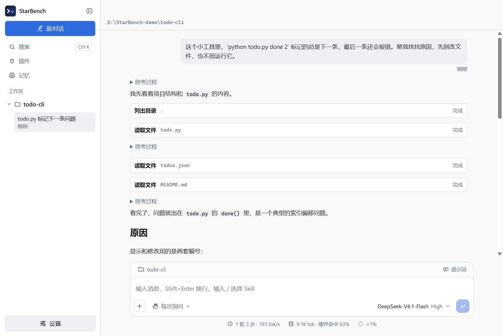

# StarBench

一个桌面端的 AI 编程助手外壳（agent harness）：选一个工作文件夹，用对话的方式让模型读写文件、搜索代码、执行命令。可以同时配置多个模型服务：DeepSeek、OpenAI、Anthropic、xAI、Google Gemini，以及任何兼容 OpenAI 接口格式的服务；OpenAI 的模型也可以用 ChatGPT 账号登录，使用 ChatGPT 套餐的额度。

> 早期版本，主要为作者自用而写。欢迎试用和提 issue。
>
> **0.1.0-r.8 及更早的版本有九个安全问题，0.1.0-r.9 起已经修复；0.1.0-r.11 及更早的版本还有九个安全和隐私问题，0.1.0-r.12 起也都已修复。** 还在用这些版本时，请不要把来路不明的文件夹（下载的压缩包、别人的仓库）选作工作文件夹；新版本里处理这类文件夹，也请保持"每次询问"，不要用"工作区内修改"或"完全权限"。详见[已知问题](KNOWN_ISSUES.md)。

<picture>
  <source media="(prefers-color-scheme: dark)" srcset="docs/images/screenshot-dark.png">
  
</picture>

## 目录

- [功能](#功能)
- [扩展](#扩展)
- [从源码运行](#从源码运行)
- [使用说明](#使用说明)
  - [模型服务](#模型服务)
  - [使用 Gemini](#使用-gemini)
  - [使用本地模型](#使用本地模型)
  - [调试本地模型](#调试本地模型)
  - [权限模式和信任文件夹](#权限模式和信任文件夹)
  - [给消息添加文件](#给消息添加文件)
  - [用量和上下文](#用量和上下文)
  - [上下文压缩](#上下文压缩)
  - [系统提示](#系统提示)
  - [记忆](#记忆)
  - [联网搜索](#联网搜索)
  - [用 ChatGPT 套餐登录](#用-chatgpt-套餐登录)
  - [同时运行多个对话](#同时运行多个对话)
  - [回答里的链接和代码](#回答里的链接和代码)
  - [其他行为说明](#其他行为说明)
- [开发](#开发)
- [打包成独立应用](#打包成独立应用)
- [安全须知](#安全须知)
  - [其他须知](#其他须知)
- [项目结构](#项目结构)
- [尚未实现](#尚未实现)
- [许可证](#许可证)

## 功能

- 流式对话，可展开查看模型的思考过程；用中文提问时，会要求模型也用中文思考
- 回答里引用的工作文件夹内的图片（例如模型生成的 `sunset.png`）直接显示在对话里，点击用系统默认程序打开；指向工作文件夹内文件的链接也可以点开。图片、PDF、文本、音视频这类打开后只是"显示"的文件直接打开；网页、SVG、Office 文档和 RTF（打开时可能运行里面的脚本或宏），以及脚本、程序等其他类型，只在文件夹里定位，不会被打开或运行；工作文件夹以外的文件不读取也不打开
- 回答里的网络图片不会自动加载：先显示它的完整地址，点击后才从网络获取（只支持 https）。模型读到带恶意指令的文件或网页时，可能被诱导把信息拼进图片地址，自动加载就等于把信息发了出去
- 回答里的网页链接点了不会直接打开：先弹出确认框，写出完整网址，网站那一段用亮色标出，确认后才在浏览器里打开。可以勾选"不再询问"这个网站，之后它的链接直接打开；这些网站列在"设置 → 通用"里，可以移除。鼠标指向链接时也会显示完整网址（见下文"回答里的链接和代码"）
- 指向 GitHub 的链接前面带 GitHub 图标，提交的哈希显示成小标签。工作文件夹是 GitHub 仓库的克隆时，回答里"PR #5""Issue #7""提交 b446e11"这类不带网址的写法也会变成链接
- 回答里的代码块显示在一个小窗里：顶上是语言名，右边是"复制"按钮，代码按语法上色；长的行横向滚动，不折行
- 对话栏的左边缘有一列刻度，你发的每条消息一根：鼠标指上去显示那条消息和回答的开头，点一下跳过去
- 输入框上方有一条栏，左边放着对话所在的工作文件夹：新对话时在这里从用过的文件夹里选择，也可以新增一个；对话开始后只显示，不能再换。第一次进入一个文件夹时，会先问你是否信任它（见下文"权限模式和信任文件夹"）。栏的右端是"提示词"按钮和插件的按钮（例如"调试"）
- 多个模型服务，各用各的 API Key；点击输入框右下角的模型名就能在它们的模型之间切换，同一个会话里也可以中途换模型
- 用 ChatGPT 账号登录后，可以不填 API Key，直接使用 ChatGPT 套餐里的额度；可以同时登录多个账号，每个账号在模型列表里各占一组（见下文"用 ChatGPT 套餐登录"）
- 可以连接自己电脑上运行的本地模型（Ollama、LM Studio、llama.cpp、vLLM 等），不需要 API Key（见下文"使用本地模型"）
- 自带"调试面板"插件：调整温度、Top-p 等采样参数，查看每次请求实际发出和收到的内容，还可以让消息以"纯对话"发出（不带任何工具，也不带应用自己的提示词）。默认只对本地模型生效（见下文"调试本地模型"）
- 输入框上面那条栏右端的"提示词"按钮可以给当前的模型服务写一段自己的系统提示：加在内置提示后面，或者替换它（见下文"系统提示"）
- 用滑杆调整思考强度，档位和名字都按各家自己的来：Anthropic 是 Low / Medium / High / xHigh / Max，OpenAI 把 xHigh 叫作 Extra High，xAI 到 xHigh 为止，DeepSeek 是关闭 / Low / High / Max，Gemini 按模型给（例如 Gemini 4 Hydrogen 是 Low 到 xHigh，几个 Flash 多一档 Minimal，见下文"使用 Gemini"）。应用认识的模型一开始就停在预设档上，并把这一档发给服务，显示的就是实际用的。预设档是各家文档写明的默认档（2026-11-23 查：Claude 多数是 High，Opus 5.5 和 Haiku 5.5 是 Medium；grok-4.5 到 4.7 和 DeepSeek 是 High；GPT-6.1 Sol、GPT-6 Sol、GPT-6 Luna、GPT-5.6 和 gpt-5.5 是 Medium），文档没写的 GPT-6.2 和 GPT-6.1 Terra 用 Medium。本地模型和应用不认识的模型没有预设：没调过时显示"默认"，不发送这个参数（有的模型不接受它）；"默认"是滑杆最左边的一档，调过之后拖回去就不再发送。选了档位而服务不接受时，应用会不带档位重发，并把档位改回去（见下文"其他行为说明"）。Gemini 没调过时同样不发送，滑杆显示 Google 文档写的这个模型的默认档。每个模型各自记住自己的档位
- 模型卡片左上角的闪电按钮是 Fast Mode：同一个模型更快地输出，价格（或套餐用量）约为 2 倍。只有服务提供这个选项的模型才能开启，同样按模型记住
- 模型卡片右上角的地球按钮是联网搜索：模型用它所在服务自带的搜索查网页、读网页（OpenAI、xAI、Anthropic、DeepSeek，以及 Gemini 3 及以后的模型用的 Google 搜索），不用另外申请 Key，对话里会显示搜了什么、找到哪些网页。费用按各家的价格另算，同样按模型记住（见下文"联网搜索"）
- 模型的版本名（例如 DeepSeek-V4.1-Flash）和它支持的思考档位从服务的模型列表里读取；服务不提供时显示你填写的模型名
- 六个内置工具：读取文件、写入文件、编辑文件、列出目录、搜索、执行命令
- 输入框左下角的权限按钮决定模型不经询问可以做什么，每个对话各自设置，分四档：仅可查看、每次询问（默认）、工作区内修改、完全权限（见下文"权限模式和信任文件夹"）
- 需要询问时，确认框里写明工作文件夹，命令里看不见的字符（例如反转文字方向的控制符）会用红框标出；也可以选"本次会话不再询问「执行命令」"这类选项
- 文件操作限制在所选的工作文件夹内
- 输入框左下角的"+"用来给消息添加文件（图片和文本文件，也可以直接拖进输入框或粘贴）、选择 Skill 和指令；输入 `/` 同样可以选，指令和 Skill 分两组列出（见下文"给消息添加文件"）
- 会话历史保存在本机，在侧栏里按工作文件夹分组，可以重命名、归档和删除，也可以从会话的"⋯"菜单里给它选一个图标，方便一眼找到。正在工作的会话，名字左边有一个转动的圆环；它停下来等你允许或拒绝一个工具调用时，圆环换成黄色的举手图标
- 可以让多个对话同时工作：一个对话在运行时，照样可以打开别的对话、开始新对话并发送消息。每个对话各自继续，切回去时显示它到那时为止的内容；在你看别的对话时完成的那些，名字左边有一个蓝点，打开后消失（见下文"同时运行多个对话"）
- 对话的标题由模型来起：一开始用你第一条消息的开头，第一轮回答完成后，应用让当前的模型另写一个说明主题的短标题（例如"帮我查找GitHub上的Windows-MCP插件"变成"Windows-MCP 总览"）。每个对话只做一次，你自己改过的名字不会被换掉；可以在"设置 → 通用"里关掉（见下文"其他行为说明"）
- 对话里，你发的每条消息下面写着发送的时间，每一轮回答的最后写着模型完成的时间：刚刚、几分钟前、今天或昨天几点、几天前，超过一个月写日期；鼠标停在上面显示完整的日期和时间。侧栏里每个对话的名字下面也写着它最后更新的时间，不想要这一行可以在"设置 → 外观"里关掉
- 鼠标停在按钮和被截断的名字上时，提示用应用自己的样式显示（不再是系统的提示框）；变灰的按钮也会说明为什么不能用
- 工作区那一行也有"⋯"菜单（右键也行）：给它改一个显示的名字，把它的对话全部归档，或者连同列出的对话一起删除。改的只是应用里的名字，文件夹和里面的文件都不动；已归档的对话下面标着它所在的工作区
- 侧栏的宽度可以拖动右边缘调整，双击恢复默认
- 侧栏可以收起成一条窄栏：点侧栏顶部右边的按钮，或者按 `Ctrl+B`。收起后只留下 StarBench 图标、展开按钮、新对话和最下面的设置；收起还是展开会记住。收起时按 `Ctrl+K`，会先展开再把光标放进搜索框
- Windows 上窗口没有系统的标题栏：侧栏顶部的图标和名字就在窗口左上角，右上角是最小化、最大化、关闭三个按钮。按住窗口顶部的空白或侧栏顶部的图标、名字可以拖动窗口
- 输入框下面有一排小工具，显示当前对话的轮数和步数、输出速度、token 用量和缓存命中、上下文占用（见下文"用量和上下文"）
- 用量："设置 → 用量"列出 StarBench 发出的请求和 token。按天记录，只存数字，保留 12 个月，跟着"统计用量和上下文"开关走。DeepSeek 的余额可以直接查到，页面上的"查询 DeepSeek 余额"开关默认关闭，打开后余额也显示在输入框下面；OpenAI、Anthropic、xAI 和 Gemini 用普通 API Key 都查不到余额，页面上改为链接到各家控制台
- 对话快要占满模型的上下文时自动压缩：先清理较早的工具结果，不够再让模型把较早的对话写成摘要。屏幕上的对话记录不变，也可以随时手动压缩（见下文"上下文压缩"）
- 记忆：模型能跨对话记住关于你和项目的事，分全局和工作区两层，存在本机，默认开着；在侧栏"插件"下面的"记忆"里查看、修改和删除。模型写入时不用确认，但输入框上方会弹出提示框，可以撤销；像是密钥或个人资料的内容先问你（见下文"记忆"）
- "设置 → 关于"里有软件版本和修订号（例如 0.1.0-r.13）、GitHub 仓库、问题提交的入口和作者信息
- 检查更新（Beta）：在"设置 → 关于"里点"检查更新"，应用向 GitHub 查询有没有比现在更新的已发布版本，有的话给出下载页面的链接，在浏览器里打开；应用不会自己下载或安装。查到新版本后，侧栏底部"设置"旁边会多一个云朵加下载箭头的按钮，点它打开"关于"页。也可以打开"自动检查更新"，启动后检查一次，每天最多一次，默认关闭。这个功能还在 Beta 阶段，Beta 版本可能不会生效（见下文"其他行为说明"）
- 侧栏顶部的搜索框按标题和消息内容查找对话（`Ctrl+K`），多个词要全部出现才算找到；思考过程和工具返回的内容不在搜索范围内
- 侧栏里的"插件"在主画面上显示插件列表，再点一次或点"返回对话"回到对话，输入到一半的文字还在。插件下面另有一组"内置功能"（目前是记忆），可以在那里关掉
- "设置"也是主画面里的一页（不再是弹窗）：左边一列分页（模型、用量、Skills、MCP、通用、外观、关于），右边是内容；模型在等你允许或拒绝时，确认框照常显示在这一页上。还没有可用的模型服务时，启动后直接打开这一页
- "设置 → 外观"里选主题：跟随系统、浅色或深色，选了立即生效并记住；不选时跟随系统。插件面板和 Google 搜索建议跟着应用的主题变
- "设置 → 模型"右上角的"添加模型"列出所有可以添加的：用 API Key 的 DeepSeek、OpenAI、Anthropic、xAI、Gemini，登录 OpenAI 账户，本地模型和其他服务。已经添加过的标着"已添加"，仍然可以再添加一个（比如第二个 Key）；"登录 OpenAI 账户"也一样，可以再登录一个账号
- 应用的通知（例如正在使用 ChatGPT 套餐、某个插件的界面出错）显示在窗口右上角，左侧色带表示种类；一般的通知会自己消失，出错的通知留到手动关闭
- API Key、ChatGPT 登录信息，以及 MCP 配置里环境变量和请求头的值，都用系统凭据加密后保存（Windows DPAPI / macOS Keychain / Linux libsecret），不会进入项目目录；换电脑或换 Windows 账户后要重新填写

## 扩展

有三种方式给模型增加能力。插件在侧边栏的"插件"页里管理，Skill 和 MCP 在"设置"里管理：

| 方式 | 你需要写的 | 适合 | 文档 |
|---|---|---|---|
| 插件 | 一个 JavaScript 模块，注册工具函数；还可以带界面，在窗口里加按钮和面板 | 需要跑代码、访问本机的能力，或者需要自己的界面 | [docs/plugins.md](docs/plugins.md)、[docs/plugin-ui.md](docs/plugin-ui.md) |
| Skill | 一份 `SKILL.md` 说明文档 | 教模型按某种流程或规范做事 | [docs/skills.md](docs/skills.md) |
| MCP | 不用写，填配置 | 接入别人已经做好的工具 | [docs/mcp.md](docs/mcp.md) |

[`examples/`](examples) 里有可以直接复制使用的示例：两个插件（一个添加工具，一个带面板）和一个 Skill。应用自带的"调试面板"（[`plugins/debug`](plugins/debug)）也是用同一套插件接口写的。应用还自带两个 Skill（[`skills/`](skills)）：`create-skill` 和 `create-plugin`，模型会照着它们，按 StarBench 的格式帮你写 Skill 和插件。

## 从源码运行

需要 Node.js 22.18 或更高版本（测试直接运行 TypeScript 文件，这是 Node 从 22.18 起默认支持的）。

```sh
npm install
npm run dev
```

首次启动会直接打开设置页，填入 DeepSeek 的 API Key 即可；想用别的服务，在"设置 → 模型"右上角点"添加模型"，从列表里选一个。

## 使用说明

下面几节对安装版、免安装版和从源码运行的版本都适用。

### 模型服务

| 服务 | 接口类型 | 实测 | 附注 |
|---|---|:---:|---|
| DeepSeek | OpenAI 兼容（Chat Completions） | ✓ | 默认服务 |
| xAI | OpenAI 兼容（Chat Completions），也可以选 Responses | ✓ | grok-4.7，两种格式都跑过；xAI 的文档现在建议用 Responses |
| OpenAI | Responses API | △ | 用 API Key 跑过（gpt-6.2-sol，2026-11-23）：带工具调用的对话、思考内容的回传和上下文压缩 |
| Anthropic | Messages API | ✓ | Claude Opus 5.5、Haiku 5.5 |
| ChatGPT 套餐 | Responses API，用 ChatGPT 账号登录 | △ | 不需要 API Key。用真实账户走通过登录、带工具调用的对话和上下文压缩（gpt-6.2-sol，2026-11-23） |
| Gemini | Gemini API（Google 自己的格式），也可以选 OpenAI 兼容 | △ | Gemini 3.5 Flash-Lite 和 Gemini 4 Hydrogen（2026-11-24）：工具调用、联网搜索、思考摘要、上下文压缩，以及从 DeepSeek 换过来接着用。OpenAI 兼容格式没有测过，详见下文"使用 Gemini" |
| 本地模型 | OpenAI 兼容（Chat Completions） | △ | Ollama、LM Studio、llama.cpp、vLLM 等，不需要 API Key。朋友用 LLaMA-Factory 和 vLLM 跑过 Qwen 3.5 9B（不开思考），其余只用本地模拟的服务验证过 |
| 其他服务 | 四种类型任选 | — | 填接口地址即可，多数第三方服务选"OpenAI 兼容" |

✓ 用真实接口测试过：取模型列表、带工具调用的一轮对话、各档思考强度，以及在同一个会话里换到别家再换回来。△ 只跑过附注里写的那几项，各档思考强度和中途换到别家没有逐项试过。

### 使用 Gemini

在"设置 → 模型"里点"添加模型"，选 **Gemini**，填入 Google AI Studio 的 API Key（`AIza` 开头），保存后在输入框右下角选模型。预设用 Google 自己的接口格式（Gemini API，地址 `https://generativelanguage.googleapis.com/v1beta`），联网搜索和思考摘要只有这种格式才有。

- 以前按"OpenAI 兼容"添加的 Gemini（地址 `…/v1beta/openai`）照常可用。在设置里把接口类型改成 Gemini API 也行，地址不用改，应用会去掉末尾的 `/openai`。
- 模型列表从 Google 读取，只列能对话的模型，显示模型名和上下文长度。
- **思考签名**：Gemini 3 及以后的回复带思考签名，Google 的文档要求下一轮原样交还。应用把每条回复逐段原样保存、原样交还，带签名的段落不拼在一起。别的模型写的工具调用交还给 Gemini 时，带上文档规定的替代值（`skip_thought_signature_validator`），所以同一个对话可以中途换到 Gemini。签名不计入 token，但会让对话记录变大（见"联网搜索"一节的实测）；压缩之后照样交还（见"上下文压缩"）。
- 思考摘要显示在"思考过程"里。Google 给的是摘要，不是完整的思考。
- Google 忙（500、502、503、504）或连接断开时，只要还没显示任何内容，应用会自动重试，最多两次；Google 指明了等待时间、并且在 10 秒以内的 429，等这么久再试。回复到一半断开时直接报错。
- 用量：Google 报整个输入里有多少是从缓存读的，思考 token 另报。Gemini 读网页时读进来的内容，Google 另计（`toolUsePromptTokenCount`），按输入收费；它不是之后要发回去的对话内容，所以不算在应用的用量统计和上下文占用里。

思考档位按模型给（2026-11-23 查 Google 的文档）。没调过时应用不发送档位，Google 按这个模型的默认档思考，滑杆上显示的就是这一档：

| 模型 | 档位 | 默认档 |
|---|---|:---:|
| Gemini 4 Neon、Hydrogen | Low / Medium / High / xHigh | High |
| Gemini 4 Carbon、Argon | Low / Medium / High | Medium |
| Gemini 3.8 Flash | Low / Medium / High | Medium |
| Gemini 3.6 Flash | Minimal / Low / Medium / High | Medium |
| Gemini 3.5 Flash-Lite、3.1 Flash-Lite | Minimal / Low / Medium / High | Minimal |
| Gemini 3.1 Pro | Low / Medium / High | High |
| Gemini 3 Flash | Minimal / Low / Medium / High | High |
| Gemini 3 Pro | Low / High | High |
| Gemini 2.5 Pro | Low / Medium / High | — |
| Gemini 2.5 Flash | 关闭 / Low / Medium / High | — |
| Gemini 2.5 Flash-Lite | 关闭 / Low / Medium / High | 关闭 |

Gemini 3 及以后的模型都关不掉思考，Minimal 最接近不思考。Gemini 2.5 按思考 token 数设置：关闭是 0，Low 是 1,024，Medium 是 8,192，High 是 24,576，和 Google 的 OpenAI 兼容接口对这几档的换算一样。默认档是"—"的，文档没写，滑杆显示"默认"。

实测（2026-11-24，Gemini API 格式；联网搜索和上下文压缩的实测写在那两节里）：

- **免费层级的 Key**，Gemini 3.5 Flash-Lite，默认档：模型列表正确（22 个模型，Flash-Lite 的上下文 1,048,576）。列目录、读文件、回答连续三步，每步 1.1–1.6 秒，输入 1,217–1,296 token。每个调用的 id 是 `call_<数字>`，带 196 个字符的签名，原样交还后 Google 接受。
- 中途换到 DeepSeek 走一步，再换回 Flash-Lite（High 档）：DeepSeek 写的调用带着替代签名交还，之后两步 Google 都接受。
- 同一时段，Gemini 4 Hydrogen 和 Gemini 3.8 Flash 关着搜索每次都回 503（"This model is currently experiencing high demand"），自动重试两次也一样，三次共 4.7–6.5 秒。Flash-Lite 也常遇到 503：一次重试后成功，两次在回复到一半时断开，还有一次三次都是 503。gemini-2.5-flash 回 404：Google 说它不再对新用户开放，请改用 gemini-3.8-flash。
- 思考 token：开通付费层级后，Hydrogen 在 xHigh 档报了 2,380，带思考摘要；Flash-Lite 在默认档和 High 档都没有报思考 token。
- 新对话的第一个请求（系统提示、工具定义和一句短问题），Flash-Lite 计 1,217 token；开着搜索是 1,296–1,299，多了搜索工具和提示里关于搜索的那句。
- 没有测到：Gemini 3.8 Flash（一直 503）；Low / Medium / High 各档之间的比较；OpenAI 兼容格式，包括它的思考签名，只在模拟服务上测过。

### 使用本地模型

在自己电脑上运行模型的程序（Ollama、LM Studio、llama.cpp、vLLM 等）都提供 OpenAI 兼容的接口，可以直接接进来。

- 在"设置 → 模型"里点"添加模型"，选 **本地模型**，再选一个常用地址（默认是 Ollama 的 `http://localhost:11434/v1`），保存即可，然后在输入框右下角选模型。地址在本机或局域网里的服务不需要填 API Key；模型跑在另一台电脑上时，把 `localhost` 换成那台电脑的地址。
- 模型最好支持工具调用（function calling），例如 Ollama 里的 `qwen3.5:9b`，并且服务要把模型写出的调用解析成 `tool_calls` 交回来。vLLM 要带 `--enable-auto-tool-choice --tool-call-parser <解析器>` 启动（Qwen 3.5 的模型卡写的是 `qwen3_coder`），llama.cpp 要开着 `--jinja`。
- **服务不接受工具定义时，改用文字方式调用工具。** 服务拒绝带工具的请求时（Ollama 报模型不支持工具、vLLM 没带上面的参数、llama.cpp 关掉了 `--jinja`），应用把这条消息重发一次：工具说明写在系统提示末尾，模型按 `<tool_call><function=工具名><parameter=参数名>值</parameter></function></tool_call>` 的格式把调用写在回答里，应用照常执行（该问你的照样问），结果放在 `<tool_response>` 里发回去。对话里会附上服务的原话说明这次切换，之后这个对话都用这种方式。没学过工具调用的小模型可能写不对格式，这时它写的内容原样显示。
- **服务接受了工具定义、却把调用原样留在回答正文里时，应用也会认出来并执行**（服务没配解析器，或者解析器和模型的写法对不上）。认识三种写法：`<tool_call>` 标签里的 JSON（`{"name": …, "arguments": …}`，Hermes、Qwen 2.5 和 3 的格式）；`<function=…><parameter=…>`（Qwen 3.5、Qwen3-Coder 的格式，外面可以有也可以没有 `<tool_call>`）；回答末尾单独成段、不带标签的 `{"name": …, "arguments": …}`（可以在代码块里）。只有名字是已提供的工具才算调用。不带标签的那种要等回答结束才认得出，认出后从回答里去掉。这一条只对本机或局域网里的服务生效（互联网上的服务会自己解析好调用），免得模型引用一段带这种标记的文字（比如你让它显示的文件内容）就被当成调用。
- **把上下文长度调大。** 系统提示加上工具说明就要占几千 token，而 Ollama 在显存小于 24 GB 时默认只给 4K 上下文，读不了几个文件就会忘记前面的内容。在 Ollama 应用的设置里拖动上下文长度的滑杆，或者设置环境变量 `OLLAMA_CONTEXT_LENGTH`（例如 `32000`）后重启 Ollama。Ollama 对这类用途的建议是至少 64000；显存不够时，尽量给到 16K 以上。
- 思考强度的滑杆对本地服务是 默认 / 关闭 / Low / Medium / High。"默认"不发送这个参数，思不思考由服务那边决定；Qwen 这类只能开关思考的模型，"关闭"就是不思考，Low 到 High 都是思考；觉得慢可以关掉。
- 思考内容不管服务用 `reasoning_content` 或 `reasoning` 字段返回，还是用 `<think>` 标签写在回答开头，都会单独显示在"思考过程"里。
- Qwen 3.5 这类模型的对话模板会自己先写好 `<think>`，服务不解析思考时（例如 vLLM 没带 `--reasoning-parser qwen3`），回答直接从思考开始，后面只有一个单独起行的 `</think>`。本机或局域网里的服务出现这种情况时，应用也会把思考分出来：一个模型第一次这样回答时，要等 `</think>` 出现才把前面的文字移进"思考过程"，之后从第一个字起就按思考显示。思考里写到的工具调用不会被执行。
- 本地服务没有启动时，模型列表和对话里的报错会直接说明连不上。
- LLaMA-Factory 的接口（`llamafactory-cli api`，默认地址 `http://localhost:8000/v1`）带工具时不能流式输出，消息还必须严格一问一答。应用发现流式请求一开始就断掉时，会改为一次取回整段回答（生成完才一起出现），在对话里说明，并且每次只执行一个工具调用。
- 服务用自己的格式返回的错误（例如 FastAPI 的 `{"detail": "..."}`）会按原话显示。
- 朋友用 LLaMA-Factory 和 vLLM 跑过 Qwen 3.5 9B（不开思考）。其余部分没有用真实的本地服务测试过：按 Ollama、vLLM、llama.cpp、LLaMA-Factory 的文档和源码、Qwen 3.5 的对话模板和一份真实的 LLaMA-Factory 报错日志实现，用本地模拟的服务验证过各种情况（"思考"字段、`<think>` 标签、带工具不能流式、服务没启动、拒绝工具定义、把调用留在正文里）。
- 文字方式只对按上面几种写法输出调用的模型有效。对两个托管模型强制用文字方式试过：DeepSeek 第一步按格式写出调用并被执行，第二步改用了它自己的调用标记；grok 没有写出调用。这两种情况应用都认不出来，会当作文字显示；它们平时走原生工具调用，不受影响。

### 调试本地模型

自带的"调试面板"插件用来调整采样参数、让消息以纯对话发出，并看清模型到底收到了什么、回了什么。在侧边栏的"插件"里打开它，输入框上面那条栏的右端会多一个"调试"按钮，点它打开对话右侧的面板。

- **采样参数**：温度、Top-p、最大输出长度各有一个开关和一个滑杆，还可以设置随机种子和停止词。只有打开的项才加进请求，改动从下一条消息起生效；有参数生效时，"调试"按钮旁边会显示"已调 N 项参数"。
- **其他字段**：服务自己才有的参数（例如 `top_k`、`repetition_penalty`）写成一个 JSON 对象，原样并入请求。LLaMA-Factory 的接口把 `presence_penalty` 当作重复惩罚来用，也填在这里。`model`、`messages`、`tools`、`stream` 这些由应用自己决定，写了不会生效，面板会提示。
- 采样参数默认只对本机或局域网里的服务生效；关掉面板最上面的"只用于本地模型"后，对所有"OpenAI 兼容"（Chat Completions）的服务都生效，其他接口格式加不了这些参数。"采样参数"那一栏的第一行会说明对当前模型是否有效。
- **纯对话（不带工具）**：打开后，消息只带着说过的话发给模型，用来看一个模型不加任何东西时的表现。
  - 不带任何工具：应用自带的、插件的、MCP 的，以及服务自己的联网搜索都没有；对不接受工具定义的服务，也不把工具写进提示词。
  - 系统提示词只有你在"提示词"里给这个模型服务写的那一份，没写就没有系统提示词。内置提示、工作文件夹的路径、系统和日期、Skill 清单、记忆都不发送，这一轮也不读写记忆。
  - 随消息添加的文件、在"+"里选的 Skill、思考强度和上面的采样参数照常发送。发给 xAI 的对话标识（见下文"其他行为说明"里"xAI 的缓存"）也照常带上，它不是给模型看的内容。
  - 记忆的指令（`/memory`、`/memory-add`、`/memory-edit`、`/memory-del`）要靠记忆的工具才做得成，纯对话对当前模型生效时带着它们的消息发不出去，会提示先关掉纯对话。
  - 对话里之前的工具调用改用文字转述：模型的回应里用一行字写明调用过哪个工具（参数最多 300 个字符），工具的结果放在随后一条用户角色的消息里，注明是当时的工具输出、不是你说的话，每个结果最多 2,000 个字符，每一行前面都加上 `| ` 作标记，所以结果里的内容冒充不了你说的话。服务要求原样带回的思考内容（签名、加密的推理）和模型的思考过程都不发送。保存的对话不变：关掉纯对话后，下一条消息照常带着完整的工具记录。
  - 纯对话里模型的回应，以后只以文字带回给服务：Anthropic 的思考是为当时那个对话签名的，换成带工具的请求后不再有效，所以不留；Responses 和 Gemini 格式也一样处理。你在对话里看到的思考过程不受影响。
  - 模型的回应里如果仍然带了工具调用，不会执行也不会保存，对话里会有一条提示；模型写在正文里的调用按普通文字显示。
  - 以纯对话发出的消息下面标着"纯对话"，以后打开这个对话也看得到；开关开着并且对当前模型生效时，"调试"按钮旁边也会显示"纯对话"。
  - 和采样参数一样，默认只对本机或局域网里的服务生效；关掉"只用于本地模型"后对所有服务都生效，不限接口格式。从下一条消息起生效，正在进行的那一轮不变。停用调试面板，纯对话也就关了。
  - 给对话起标题的那个小请求和上下文压缩不受它影响，照常进行；压缩时按纯对话实际发出的大小来算。
  - 纯对话是用本地模拟的服务验证的，另外用 DeepSeek 的真实接口试过四轮很短的对话（2026-11-24，deepseek-flash）：没有工具、没有系统提示词的请求它接受，用过工具的对话改成文字转述后它答得出工具当时读到的内容，之后关掉纯对话，带着完整工具记录的请求它也照常接受。Gemini 的原生接口也用真实服务试过六轮（2026-11-24，Gemini 3.5 Flash-Lite 和 Gemini 4 Hydrogen）：纯对话的请求里只有对话内容，之前的搜索和工具调用按文字转述，都被接受；之后回到带工具的请求、在一轮被停掉之后紧接着发纯对话，也都被接受。Anthropic 和 Responses 这两种接口格式下只检查过发出的请求是什么样子，没有向真实服务发过；用 ChatGPT 套餐登录、又没有写自己的提示词时，请求里没有系统提示词，那边接不接受没有试过。本地模型服务（Ollama、LLaMA-Factory、vLLM）也没有实际试过。
- **请求记录**：当前对话的每次请求一行，显示时间、模型、结束原因、输入输出 token 数和输出速度。点开可以看到并复制实际发出的参数和请求头、完整的请求体、服务报告的用量，以及应用读到的回应（思考、回答和工具调用；模型写在正文里的，显示的是应用认出来的结果）。Anthropic 格式下请求体是应用自己的表述，面板上会注明。只保留最近 12 条，关掉应用就没有了，记录里没有 API Key。
- 上下文长度不是请求里的参数：Ollama、LLaMA-Factory 都是在服务那一边设置的（见上一节）。记录里的输入 token 数可以用来看上下文用了多少。
- 用量来自模型服务的报告（见下文"用量和上下文"）。服务不报用量时，记录里没有 token 数，速度按回应到达的段数估计（前面带"约"）。
- 这个插件没有用真实的本地服务测试过，是用本地模拟的服务验证的。

### 权限模式和信任文件夹

输入框左下角的按钮写着当前对话的权限模式，点它可以换。模式决定模型**不经询问**可以做什么：

| 模式 | 读取、列目录、搜索 | 写文件、编辑文件 | 执行命令，MCP 和插件的工具 |
|---|---|---|---|
| 仅可查看 | 直接执行 | 不执行 | 不执行 |
| 每次询问（默认） | 直接执行 | 每次先问 | 每次先问 |
| 工作区内修改 | 直接执行 | 直接执行 | 每次先问 |
| 完全权限 | 直接执行 | 直接执行 | 直接执行 |

- 模式跟着对话走：新对话从"每次询问"开始，换过的模式保存在对话里，下次打开还是它。对话正在工作时也可以换，从下一个工具调用起生效；已经弹出来的确认框仍然等你回答。
- "仅可查看"下被拦住的调用不会询问，对话里标着"存取被拒（仅可查看）"，模型会被告知这个对话只能查看。
- 你拒绝的调用标着"存取被拒"，按停止打断的标着"已取消"。这几种都是你自己的决定而不是出错，所以卡片是黄色边加警告图标；真正的失败和超时是红色的字。
- "工作区内修改"放行的只是应用自带的写文件和编辑文件，它们写不出工作文件夹；命令不受这个限制，所以仍然先问。写 `.git`、`.vscode`、`.idea` 里的文件除外：git 和编辑器会自己运行这些文件夹里写的命令，所以仍然先问。
- "完全权限"下按钮是红色的。命令能做你的账户能做的任何事，不限于工作文件夹，请只在清楚模型要做什么的时候使用。
- 声明了"只读、不需要确认"的插件工具在任何模式下都直接执行，和以前一样。

第一次在某个文件夹里开始对话之前，应用会问**是否信任这个文件夹**。选择文件夹本身不会运行或加载里面的任何东西；信任的意思是：模型可以不经询问读取这个文件夹里的文件，读到的内容会发给模型服务。修改文件和执行命令仍然按上面的权限模式来。选"取消"就留在原来的文件夹。信任过的文件夹不再询问；在侧栏里把工作区删除后，下次再选它会重新问。升级前已经用过的文件夹算作已信任。

### 给消息添加文件

点输入框左下角的"+"→"添加文件…"，或者把文件拖到输入框上，或者直接粘贴（例如截图），文件会显示在输入框里，发送前可以点"×"拿掉。一条消息最多带 10 个文件，不要求文件在工作文件夹里。

- **图片**（PNG、JPEG、GIF、WebP，BMP 和 AVIF 会转成 PNG）作为图片发给模型。长边超过 2000 像素或大于 4 MB 的会先缩小。
- **文本文件**（代码、Markdown、日志、CSV、JSON 等，1 MB 以内，最多 20 万字符）的内容放在你输入的文字前面，文件名一起告诉模型。UTF-8、带 BOM 的 UTF-16 和系统代码页（如 GBK、Big5）的文件都能读。
- 其他类型（PDF、Office 文档、压缩包等）还不能添加；这类文件放进工作文件夹后，可以让模型用工具去处理。
- 模型不能看图片时（例如只收文字的服务、没有配视觉模块的本地模型），服务会拒绝带图片的请求。应用会自动改成只告诉模型图片的文件名再发一次，并在对话里提示；图片仍然留在对话里，换成能看图的模型后会照常发送。
- 图片保存在对话记录里，带图片的对话文件会比较大；每张图片在上下文占用里按大约 1,500 token 估算。调试面板和旁观请求的插件看到的记录里，图片数据换成一句说明。
- 实测（2026-11-24）：一张 96×96 的纯红 PNG，问主要是什么颜色，deepseek-flash（思考关闭，Chat Completions 格式）、claude-haiku-5-5（Low，Anthropic 的 Messages 格式）、grok-4.7（Low，Responses 格式）各问一次，都答红色；一个三行的 Markdown 文件，问第二行写的是什么，deepseek-flash 答对。OpenAI 自己的接口（API Key 和 ChatGPT 登录）和 Gemini 收图片还没有实测。服务拒绝图片后只发文件名重试这条路，只在模拟服务上验证过，没见过真实服务的拒绝。选择文件的对话框和拖放没法自动操作，实测走的是粘贴，三种方式读文件用的是同一段代码。

### 用量和上下文

对话里有了第一条回应之后，输入框下面会出现三个小工具。鼠标移到上面有一句提示；点一下展开明细，再点一下、点别处或按 `Esc` 收起。

- **会话统计**：发了几条消息（轮）、模型被请求了几次（步，模型每用一次工具就多一步）、模型用时、工具调用用时（不含等你确认的时间）、首 token 的平均等待，以及输出速度。
- **Token 用量**：整个对话累计的 token，分成未缓存的输入、从缓存读取的输入和输出；服务另外报了"思考"或"缓存写入"时会多一行（缓存写入 Claude 和 OpenAI 会报，OpenAI 是 gpt-5.6 以后的模型）。缓存命中是从缓存读取的部分占全部输入的比例。
- **上下文占用**：最近一次请求之后上下文里有多少 token、占模型上下文长度的百分之几、还剩多少，并按类别列出：对话消息、思考、压缩摘要、工具调用和结果、内置工具、插件工具、MCP 工具、系统提示词、自定义提示词、Skills 列表、记忆。各类别按文字长度估算，服务报告了用量时合计对齐到它的数字。"思考"是随回复带回去的思考，没有文字可估，取的是报告的用量里超出文字的部分；服务没报过思考 token，或者应用还不知道系统提示和工具各占多少时，它算在"对话消息"里。

几点说明：

- 数字来自模型服务自己的报告，随对话保存，重启后还在。服务没有报告的项显示"—"，不显示 0：本地服务一般不报告缓存；LLaMA-Factory 在流式回应里不报用量，这时 token 数是"—"，速度按回应到达的段数估计，前面带"约"。
- 上下文长度依次取自：你手动填的、模型服务报告的（Anthropic、DeepSeek 和 Gemini 会报）、应用内置的常见模型表（2026-11-22 从 DeepSeek、OpenAI、xAI 的文档查得）。都没有时只显示已用的数量；可以在卡片里点"填写"，按模型记住（本地模型填它在服务那边实际设置的数值）。
- 为了拿到用量，发给 OpenAI 兼容服务的流式请求里会多一个 `stream_options` 字段；服务明确拒绝它时，应用会去掉它重发，之后不再向这个服务发它。不想统计，可以在"设置 → 通用"里关掉"统计用量和上下文"：这一排不再显示，也不再多发这个字段。
- ChatGPT 套餐还剩多少额度显示不了：OpenAI 没有提供查询的接口，要到"管理用量"的网页上看。
- **xAI 的缓存**：xAI 把读过的内容缓存在处理那次请求的服务器上，下一次请求落到别的服务器，之前的内容就要按全价重读。所以应用给每个对话带一个固定的标识，让 xAI 尽量把请求送到同一台服务器：Chat Completions 格式用请求头 `x-grok-conv-id`，Responses 格式用字段 `prompt_cache_key`，都是 xAI 文档里的做法。标识由对话的 id 算出，看不出对话内容；只在接口地址是 `api.x.ai` 或它的区域地址（`us.api.x.ai`）时才发，调试面板的请求记录里看得到。2026-11-23 用 grok-4.7 实测：不带标识时，5 次后续请求里只有 1 次命中缓存，其余几次只有开头的 1,152 个 token 是从缓存读的（其中一次的输入是 8,249）；带上之后，Chat Completions 格式 19 次里命中 15 次，Responses 格式 8 次里命中 5 次，命中时之前发过的内容有 96% 以上从缓存读。没命中的几次里，两种格式各有一次是隔了二十多分钟才发的，紧接着的下一次又命中了；其余几次没有间隔也落空了。xAI 说明这是尽力而为，缓存也会被清掉。从缓存读的输入，grok-4.7 按四分之一的价格计。
- **OpenAI 的缓存**：OpenAI 自己找缓存，应用不带标识。2026-11-23 用 gpt-6.2-sol 实测（连读四个文件再追问一句，共 6 次请求）：用 API Key 时，从第三次请求起，之前发过的内容除系统提示外都从缓存读（最后一次输入 7,743，其中 7,340 来自缓存）；系统提示约 295 个 token 每次都按未缓存计，因为 gpt-6.2 起 `instructions` 排在对话之后，不进缓存。新内容第一次发出时计为"缓存写入"，文档写的价格是普通输入的 1.25 倍，之后从缓存读是 0.05 倍。用 ChatGPT 套餐登录时，同样 6 次请求的缓存读取和写入全是 0；把请求照套餐通道的写法（工具分在一个组里）用 API Key 发，缓存照常，所以差别在服务那一边。文档里控制缓存的两个字段（`prompt_cache_options`、`prompt_cache_breakpoint`）用 API Key 有效，在套餐通道上被拒绝（`not supported on this model`），所以套餐通道目前用不上缓存。带上对话标识（`prompt_cache_key`）试过，两条通道的数字都没变：按文档，gpt-5.6 以后的模型不靠它找缓存，它只把缓存按标识隔开。
- **Gemini 的缓存**：应用没有用 Google 的显式缓存，也不带标识，Google 报告的缓存读取是它自己命中的。2026-11-24 两段只用 Gemini 3.5 Flash-Lite 的对话，整段累计的缓存命中在第 4 轮后是 14% 和 16%，到结束时（中间压缩过）是 4% 和 7%；每次请求从缓存读了多少没有记下来。
- 上下文快满时会自动压缩，卡片底部写着在什么时候，旁边是"立即压缩"的按钮（见下一节）。

### 上下文压缩

对话越长，每次请求带的内容越多，迟早会超过模型的上下文长度。应用在那之前把对话压缩，分三步，从最便宜的开始：

1. **工具结果先裁到放得下**：一步里的工具结果合起来最多占"压缩线"的四分之一（压缩线默认是上下文长度的 80%，所以是上下文长度的 20%）。超出的部分截掉，末尾注明还有多少字符没有显示，模型可以用 `offset`、`limit` 分段再读。上下文很长的模型不受影响（单个结果本来就有 3 万字符的上限），小上下文的本地模型会明显变短。
2. **清理较早的工具结果**：占用到了压缩线时，较早的工具结果在发给模型的内容里换成一行说明（结果已清理，需要时重新读取或执行），最近的一批保持原样，大约是当时占用的四分之一。这一步不请求模型，马上完成。加载过的 Skill 不会被清理。
3. **写摘要**：清理之后仍然高于压缩线的四分之三，或者没有什么可清理的，就请当前模型把较早的对话写成摘要，最近的一部分对话原样保留。交给模型的较早对话里，也写着模型自己搜过的网页（搜了什么、找到哪些网页、读了哪个网页），回复正文没提到的搜索也不会丢。摘要后面，应用自己再附上你说过的原话（第一条和最近的几条）以及读过、改过的文件清单，这两样不经过模型转述。

压缩只改变**发给模型的内容**，屏幕上和磁盘上的对话记录一条不少。对话里会多出一条分隔线，写着做了什么、占用从多少降到多少（先是估算，前面带"约"，下一次请求返回后换成服务数出的数字），写了摘要的可以点"查看摘要"。分隔线以上的消息变淡，表示模型已看不到原文；被清理的工具结果标着"结果已清理"，点开仍是完整内容。

- **什么时候压缩**：每次请求之前检查。默认在占用达到上下文长度的 80% 时压缩，可以在"设置 → 通用"里改成 50% 到 95%，或者关掉。还可以另设一个 token 上限（例如 200K），超过就压缩，不管模型的上下文有多长，长上下文模型这样能少花钱。有的服务按长度分档计价：按 xAI 的价目表（2026-11-23 查），grok-4.7 的输入达到 20 万 token 后整次请求按双倍单价计，上限设在 20 万以下可以避开。
- **不知道上下文长度时**（多数本地模型）：不会自动压缩，除非设了 token 上限，或者在上下文小工具里填了长度。模型服务明确报告"对话太长"时，应用会压缩后重发一次；报错里写了上下文长度的，这一轮余下的请求就按它来。
- **手动压缩**：上下文小工具的卡片底部有"立即压缩"，随时可以点；没有什么可压时会说一声。它在"统计用量和上下文"开着时才看得到。
- **停止和失败**：写摘要时按"停止"，什么都不改。摘要没写出来（服务出错、模型没回应、输出长度用完被截断、只写了思考）时，对话照原样继续并说明原因，能清理的工具结果仍然清理，不会拿半截内容或思考当摘要。只有一种情况分辨不出来：本地模型把思考直接写在正文里、没有开头的标签，应用这次启动后还没见过它这样做，而服务器又在它思考到一半时把回复当作正常结束，这时那段思考会被当成摘要。
- **用量**：写摘要是一次真实的请求，token 计入用量统计，但不算对话的一"步"。压缩过的对话，会话统计里多一行"上下文压缩"。

几点代价和限制：

- **缓存**：对话的开头一变，服务就要把后面的内容重新读一遍，而不是从缓存里取。所以不是每轮削一点，而是到线才压，一次降到线的四分之三以下。
- **Claude 的思考**：Claude 的思考带签名，和它之前的全部内容绑在一起。前面的内容被清理或摘要改动后，改动处后面的思考不能再发回去，应用会把它们去掉；屏幕上的"思考过程"不受影响，模型之后照常思考。
- **Gemini 的思考签名**：压缩后，留下的 Gemini 回复连同签名原样交还，不像 Claude 那样去掉。2026-11-24 用 Gemini 3.5 Flash-Lite 的真实接口（开着搜索；两次自动压缩把 token 上限设成 4,000）试过三种情况，Google 都照常回复，没有报错，压缩之后的回答也对：
  - 一轮开头自动压缩：较早的 11 条消息（包括带搜索的回复）写成摘要，占用从 4,432 降到 1,666，之后读文件、回答的四步都正常。
  - 手动压缩：占用从 4,249 降到 1,893，留下的两轮里有搜索段落和带签名的段落。
  - 一轮中途压缩：这一轮读了两个文件之后写摘要，摘要盖住了这一轮的提问和第一个文件，占用从 4,297 降到 2,822；下一个请求是"摘要 + 接着做"，后面接着第二个文件的调用（签名是压缩前写的）和结果。
  
  别的 Gemini 模型、比这更长的对话没有试过。写摘要的请求不带工具和搜索；模型回复里的思考不会被当成摘要，这一点只在模拟服务上测过。
- **摘要会丢细节**：先清理工具结果，就是为了尽量推迟写摘要。小模型写的摘要质量有限。
- **占用怎么算**：以服务对上一次请求的实际计数为准，加上那次回复的 token（连思考），再加上之后新增内容的估算。各家计数差别很大，实测：xAI 把"系统提示 + 工具定义"按文字估算值的 2.3 倍计，Claude 约 1.8 倍，DeepSeek 约 1.3 倍，OpenAI 约 0.8 倍；xAI 还把每条回复的思考 token 全部计入之后的每次请求，一条几百字的回答可能占掉上万 token。所以应用给每条回复记下服务报告的 token 数，压缩时按它衡量，不只看文字长短；这部分在上下文小工具里列为"思考"，分不出来时算在"对话消息"里。思考写在正文里时（本地模型常见，带 `<think>` 标签或不带开头标签）应用不把它发回去：服务数出的回复 token 按回答和思考的文字长短分摊，只有回答那一份算进占用，用量统计仍按整条回复计。
- **思考为什么会重复计入**：2026-11-23 用同一段对话对照过。xAI 的 Chat Completions 格式下，是 xAI 在它那一边留着每条回复的思考，只要请求里对话的开头和那条回复的文字一字不差，就把思考接回去：应用回不回传，计入的数量都一样（回传时输入 8,249，接着不回传是 8,317，多出的是新说的一句话），xAI 的文档里也没有关掉它的参数。xAI 的 Responses 格式下，思考加密后交给应用、再由应用带回去：带回时输入 9,095，不带回是 2,569；xAI 的文档要求原样带回，否则模型接不上之前的思路，缓存也容易落空。OpenAI 自己的接口也这样计：带回时输入 1,718，不带回是 1,018。DeepSeek 的文档要求带工具的请求回传全部思考，同样计入输入（实测带回 2,413，不带回 1,538）。应用都按文档做：不带回能省下这些输入，代价是模型看不到自己之前的思路。这部分占用要等压缩把那段对话换成摘要才会消失；在 xAI，一条回复的思考在紧接着的那次请求里按全价计一次，之后落到同一台服务器时从缓存读，价格是未缓存的四分之一（见上一节"xAI 的缓存"）。
- **没有计数时**：服务不报用量，或者关掉了"统计用量和上下文"时，只能按文字长度估算，可能偏低；这时靠"服务报告太长后压缩重发"兜底。
- 这个功能用 DeepSeek、Claude、xAI（Chat Completions 和 Responses 两种格式）、OpenAI（API Key 和 ChatGPT 套餐两条通道）和 Gemini（Gemini API，2026-11-24，Gemini 3.5 Flash-Lite）的官方接口实际跑过：清理工具结果、手动压缩、写摘要，以及压缩之后接着对话。OpenAI 和 Gemini 报"对话太长"后压缩重发这一步没有实际触发，只按报错原文核对过应用认得出来；Gemini 的测试用的是这条报错常见的原文（"The input token count … exceeds the maximum number of tokens allowed …"），只在模拟服务上测过，没有见过真实接口返回它。本地模型是用本地模拟的服务验证的。

### 系统提示

每个请求都带一段应用内置的系统提示：模型在这里担任编程助手、工作文件夹和系统环境，以及几条工作守则。点输入框上面那条栏右端的"提示词"按钮，可以看到这段内置提示的原文（"查看内置提示"），也可以写自己的。

- 内置提示把"编程助手"写成一份工作，而不是模型的名字，并且写明当前用的模型名和服务名，让模型被问到"你是谁""你是什么模型"时照着回答。不写的话，实测有的模型只会说自己是编程助手，有的会说成别家的模型。
- 你用中文（简体或繁体）、日文或韩文提问时，内置提示的最后会多一行，写明你用的是哪种语言，并要求模型的思考过程也用它来写。起因是 DeepSeek 默认用英文思考。实测（deepseek-flash）只写"用用户的语言思考"这类话基本无效，把整段提示换成中文也无效，加重语气但让模型自己判断语言时，7 次里只有 3 次用中文；直接写明"用户用的是中文"之后，试过的十几个问题全部用中文思考，包括中途调用工具、问题里贴了英文报错和思考强度调到 Max 的情况。繁体提问时思考也是中文，多数是繁体字；日文试过一次有效；韩文两次里只有一次有效。用其他语言提问时不加这一行。
- 这一行看的是整个对话：以你最近一条带有中文（或日文、韩文）的消息为准，只发"ok"、一个路径或一段英文报错不会让它变回英文。回答用的语言不受这一行影响，仍然跟着你最后一条消息走。
- 自己写的提示词跟着模型服务走："提示词"按钮改的是当前这个服务的，换用别的服务时用那个服务自己的。设置了之后按钮会变色。
- 默认加在内置提示后面，两者模型都会看到。适合放固定的要求，例如回答用的语言、代码风格。
- 勾选"用它替换内置提示"后，模型只看到你写的内容，后面附上工具要用的几行环境信息（工作文件夹、系统、命令行、日期）和 Skill 清单、记忆；内置的工作守则、模型名和思考语言的要求都不再发送（想让模型用中文思考，可以照抄内置提示的最后一行）。适合微调过的模型：把训练时用的那段系统提示填在这里。
- 修改从下一条消息开始生效。
- 以纯对话发出的消息不带内置提示，只带你自己写的这一份，没写就没有系统提示词（见上文"调试本地模型"）。

### 记忆

模型可以跨对话记住关于你和项目的事：你的习惯和偏好、你纠正过它的地方、项目里代码看不出来的决定。侧栏"插件"下面的"记忆"打开记忆页。

- 全局的记忆在所有工作区的对话里都用，工作区的只在那个工作区里用。每条是一个 Markdown 文件，存在应用数据文件夹的 `memory/` 里，不写进你的工作文件夹。
- 模型用 `remember`、`forget`、`recall` 三个工具读写，不需要你确认。写入、修改、删除之后，输入框上方会弹出提示框，可以查看或撤销，8 秒后自己收起（鼠标停在上面或窗口不在前台时不倒数）。像是密钥、密码或个人资料的内容，先问你要不要写入。模型新写或改过的全局记忆先标"待确认"，只在写下它的那个工作区里用，你在提示框或记忆页设为全局后才进入所有工作区，用 `/memory-add`、`/memory-edit` 指令明确要求时不用确认；你自己写过、改过的记忆，模型要改要删都会先问你。这样文件或网页里藏的指令，没法悄悄往所有工作区加记忆，也没法悄悄改掉你写的记忆；模型自己写的记忆它仍能删除，删除后提示框里可以恢复（见 [docs/memory.md](docs/memory.md)）。
- 每个对话在第一轮把记忆拍成快照，整个对话都用这一份，系统提示的开头不变，提示缓存不受影响。模型在这个对话里新记的从下一个对话起才进入清单；你在记忆页里的改动和删除从下一轮起生效。
- 清单默认最多 3,000 token，记忆页底部可以调；上下文小的模型只用上下文的 5%。记忆页底部也能给每个模型服务选"读写""只读"或"不用"。本地模型对话里记下的默认只发给本地模型。
- 记忆会随请求发给当前的模型服务。不想让某个服务看到，把它设成"不用"；整个功能可以在"插件"页的"内置功能"里关掉。
- 输入 `/` 或点"+"→"指令"，可以用 `memory`、`memory-add`、`memory-edit`、`memory-del` 查看和整理记忆，也可以直接跟模型说"记住……""把那条删掉"。

详见 [docs/memory.md](docs/memory.md)。

### 联网搜索

模型卡片右上角的地球按钮，让当前模型使用它所在服务自带的联网搜索。搜索由服务自己完成，应用不在本机打开网页，也不需要另外的搜索 Key；搜索词和要读的网址由应用发给这个模型的服务（它本来就能看到对话），再由服务去搜索、去访问那些网址：网址里带着什么，那个网站就会收到什么。模型被网页或文件里藏的指令诱导时，可能把对话内容放进它要读的网址，所以处理敏感内容时请关掉联网搜索（见[已知问题](KNOWN_ISSUES.md#n25-联网搜索要读的网址由服务去访问)里的 N25）。

| 服务 | 连接格式 | 用的工具 | 费用（2026-11-23 查） |
|---|---|---|---|
| OpenAI（API Key） | Responses | `web_search` | 每千次 10 美元，另加 Token |
| OpenAI（ChatGPT 套餐） | Responses | `web_search` | 算在套餐额度里 |
| xAI | Responses | `web_search` | 每千次 5 美元，另加 Token |
| Anthropic | Messages | `web_search_20250305`、`web_fetch_20250910` | 搜索每千次 10 美元，读网页不另收费，都另加 Token |
| DeepSeek | Chat Completions | `deepseek_web_search` | 不按次收费，只算 Token |
| Google（Gemini 3 及以后） | Gemini API | `googleSearch`、`urlContext` | 每月前 5,000 次搜索免费（Gemini 3 及以后的模型共用），之后每千次 14 美元，每天最多 1,500 次；按模型实际搜的每个搜索词计费；读网页只算 Token。免费层级的 API Key 不能用 |

- 只有上表的组合能打开，别的服务、网关和本地模型上按钮是灰的。xAI 要用 Responses 格式连接，它的 Chat Completions 格式没有搜索；Gemini 要用 Gemini API 格式连接（预设就是），它的 OpenAI 兼容接口在对话里不支持搜索。
- 对话里每次搜索显示成一行"搜索网页"，读网页是"读取网页"，点开能看到找到的网页；点其中的链接和点回答里的链接一样，先确认再在浏览器里打开。这些都在服务那边执行，不弹确认框。
- DeepSeek 只有开着思考时才能联网搜索：它不允许在不思考的请求里同时放自己的搜索和应用的工具，实测会返回 400（"client tools can only be used together with `deepseek_web_search` in thinking mode"）。思考强度调到"关闭"时，地球按钮变灰，这期间不搜索；开关本身保持不变，打开思考后照常搜索。
- DeepSeek 开着搜索时，`search`、`image_search`、`open`、`find` 是它保留的工具名，用了就报 400（2026-11-23 实测："the name `search` is reserved when `deepseek_web_search` is used"）。所以这时应用自己的搜索工具改叫 `search_files` 发给 DeepSeek，模型调用回来再换回原名；搜索关着时照旧。
- 打开时，内置提示里多一句：联网搜索已开启；除了应用自己的文件和命令工具，服务还自带搜索和读网页的工具，所以模型确实能上网；遇到可能已经变化或拿不准的事要先搜索，并写出用到的网页。最初这句只写了"可以用服务自带的工具搜索"，DeepSeek deepseek-flash 有时会回答自己没有联网工具：2026-11-24 问 Electron 最新版，high 和 low 两档共 24 次，有 9 次这样回答。改成明说之后，16 次都去搜了。别的问题（TypeScript 新版本、本周科技新闻）改前改后都照常搜索。不过 low 档的结果会随 DeepSeek 那边变化：两小时后（2026-11-24 02:10）用新打的包复测，同一句提示在 low 档 8 次只搜了 1 次，用调试面板看过请求，搜索工具和这句提示都在；high 档 4 次都搜了。
- 搜索记录随回复交还给同一个服务，下一轮接着用（实测 xAI 不带它时会重新搜一遍）。关掉搜索后，带搜索的旧回复里，搜索的部分换成一句说明：之前搜过什么、读了哪些网页，内容不再重复。实测 Claude 收到旧的搜索结果却没有搜索工具时，会把引用标记当成文字写进回答；把搜索的部分整个删掉，它又会否认自己搜过。换成说明之后，这两种情况都没有再出现。
- Claude Opus 5.5 把签过名的思考和它前面的对话内容绑在一起。关掉搜索后，请求里的工具和系统提示变了，2026-11-23 实测：开着搜索聊两轮，关掉搜索再问，第 3 轮报 400（"Invalid `signature` in `thinking` block … bound to a different conversation"）。现在在 Anthropic 的官方接口上，请求里用了自适应思考（adaptive thinking）时，都带上 `thinking.block_binding.prefix_mismatch_behavior: "drop_block"`（测试版功能 `thinking-binding-controls-2026-08-01`）：前文对不上时，服务丢掉旧的思考接着回答，屏幕上的"思考过程"不受影响。Haiku 5.5 也接受这个设置。改提示词、隔天接着聊（系统提示里的日期变了）同样会让前文对不上，也一并照这样处理。
- Claude 每一步最多搜 8 次、读 8 个网页，每个网页最多读 4 万 token；它只能读对话里已经出现过的网址，这是 Anthropic 那边的限制。Claude 新版的搜索工具默认先写代码筛选结果，实测更慢、更费 Token，所以用的是直接调用的版本。
- Gemini 的搜索和函数工具能不能放在同一个请求里：Google 的文档（"Combine built-in tools and function calling"，2026-11-23 查）写明 Gemini 4 和 Gemini 3 可以，目前是预览功能，请求里要打开 `toolConfig.includeServerSideToolInvocations`，开了以后函数调用默认用 `VALIDATED` 模式。Gemini 2.5 及更早的模型在这种接口里只能二选一，所以它们的地球按钮是灰的。
- Gemini 把自己的每次搜索和读网页作为 `toolCall` / `toolResponse` 交回来，每一段都带思考签名；文档要求下一轮把所有段落连同签名原样交还，应用照做。关掉搜索后，带搜索的旧回复里这几段换成一句文字说明。找到的网页链接是 Google 的跳转地址（`vertexaisearch.cloud.google.com/grounding-api-redirect/…`），标题是网站名，点开后经 Google 跳到原网页。
- Google 对显示方式有要求。Gemini API 附加服务条款（Additional Terms of Service）"Grounding with Google Search"一节（2026-03-23 起生效）写明：带搜索的回答（Grounded Results）只能连同它附带的"搜索建议"（Search Suggestions）一起显示给提问的人，不能修改，也不能在中间插入别的内容；除了对话记录等几种情况，不能缓存、保存或分析这些结果和搜索建议。搜索建议是 Google 给的一段 HTML，一排指向 Google 搜索的按钮。它跟着每次搜索的 `toolResponse` 一起来（`search_suggestions`），有时也在回复最后的 `groundingMetadata.searchEntryPoint.renderedContent` 里。StarBench 把它原样显示在那次搜索的"搜索网页"一行下面，不折叠，跟着应用的深色或浅色外观。它放在一个单独的框里，框里不运行脚本，也碰不到应用。点按钮时，应用在浏览器里打开对应的 Google 搜索，中间不经过别的页面。搜索建议和回答一起存在对话记录里，重新打开对话时照样显示。
- Gemini 实测（2026-11-24）：
  - 免费层级的 Key：凡是开着搜索的请求，Google 都在 0.1 秒内回 429 "You exceeded your current quota"，报错里没有说是哪一项额度；同一个 Key 关掉搜索就能正常对话，和价目表上"免费层级不提供"一致。所以开着搜索遇到 429 时，应用会在报错后面补一句：免费层级的 Key 要关掉搜索再发。
  - 开通付费层级后：
    - Gemini 3.5 Flash-Lite（默认档 Minimal）问"Electron 现在最新的稳定版"：一次搜索、两个搜索词、两个网页，2.5 秒答对并附上网页（输入 1,296、输出 113 token）。下一轮让它读文件并查 Node.js 的 LTS 版本：先用应用的搜索工具找文件（0.9 秒），再用 Google 搜索并回答（3.4 秒），两件都做了；上一轮的搜索段落连同签名交还，Google 接受。关掉搜索后再问，0.8 秒，答案照常。
    - Gemini 4 Hydrogen 在 xHigh 档搜了两次，又读了两次网页（第一次的两个网址都打不开，第二次读了三个 Google 跳转链接），44 秒答对 TypeScript 的版本：输入 2,006、输出 581、思考 2,380 token，带思考摘要。这一轮是从 Flash-Lite 换过来、搜索关了又开之后问的，带着旧签名 Google 都接受。
  - 实际返回和文档一致：搜索和读网页作为 `toolCall` / `toolResponse` 逐段交回来，`groundingMetadata` 在最后一个事件里。
  - 每次搜索的 `toolResponse` 带一个很长的思考签名（实测 27,376 到 56,440 个字符），要原样交还；Google 自己的搜索调用上的签名是 412–2,708 个字符，工具调用和回答末尾的只有 196–204 个。这样对话记录每搜一次会大几十 KB，但 Google 不把签名算进输入 token：带着 27 KB 签名的下一次请求，输入只多了 116 token。
  - 搜索建议的 HTML 每次 4.6–5.2 KB，显示成 820×50 的一排按钮，深色和浅色外观都正常，没有报错。用模拟的鼠标点按钮，应用请求打开的是对应的 Google 搜索（`https://www.google.com/search?q=…&client=app-vertex-grounding&safesearch=active`）。
  - 模型常常去读搜索结果里的 Google 跳转链接，"读取网页"一行的地址就是那串链接；读到的网页按搜索结果给的标题显示。
  - Google 回复中途也可能断开并发来 503（需求过高），这时报错显示，已经出来的文字不保存。
- 实测（2026-11-23，问"Electron 现在最新的稳定版"）：DeepSeek deepseek-flash 3.6 秒，Grok grok-4.7 3.0 秒，Claude Opus 5.5 4.4 秒，都答对并附上网址。GPT 在 2026-11-24 用 ChatGPT 套餐登录测过（gpt-6.2-sol，思考强度 xhigh）：26.5 秒答对并附上网址；接着追问，以及关掉搜索后再问，回答也都正常。一开始用套餐登录时，应用没有请求"找到的网页"列表，搜索记录里只有搜索词。改成请求之后再测（31.3 秒），套餐这条路线也接受，每次搜索都列出了找到的网页（四次搜索分别是 20、20、20、6 个）。用 API Key 时同样会请求这个列表，但还没有实测。

### 用 ChatGPT 套餐登录

API Key 是按量计费的，和聊天产品的订阅分开。OpenAI 为开源应用提供了一种官方的登录方式（[Sign in with ChatGPT](https://developers.openai.com/siwc/token-sharing-open-source)），登录后请求计入你 ChatGPT 套餐的额度。StarBench 用的就是这种方式，没有模拟官方客户端，也不读取网页版的登录状态。

- 在"设置 → 模型"里点 **Continue with ChatGPT**；或者点"添加模型"选 **登录 OpenAI 账户**，再点那个按钮。登录和授权在你自己的浏览器里完成，应用看不到你的密码；完成后浏览器跳回本机的 `http://127.0.0.1:1455/auth/callback`（这个端口被占用时换一个），应用在那里接收结果。
- 登录得到的令牌加密保存在本机，一小时过期一次，由应用自动续期。退出登录时会通知 OpenAI 撤销；通知不到时应用会告诉你，你可以到 ChatGPT 的设置里断开 StarBench。
- 能用哪些模型由账号的套餐决定，应用从 OpenAI 返回的列表里取。
- 达到用量上限时应用会停下来，给出去 ChatGPT 用量页面的入口，不会自己改用别的付费方式。
- OpenAI 把这项功能标为预览，能不能用取决于你的账号和 OpenAI 开放的范围。应用按它的要求发请求：不保存会话（`store: false`）、流式返回、工具放在一个命名空间里。
- ChatGPT Business 的工作空间需要管理员先放行：在 [admin.openai.com](https://admin.openai.com/external-access) 的"外部访问（External access）"里，把"所有开源软件 (OSS)"的"使用 ChatGPT 套餐"设为允许。没有放行时，登录页面会显示"你所在组织限制对此开源应用的访问"（`3p_delegated_access_policy_denied`）。
- 登录、选模型和对话已经用真实的 ChatGPT 账户走通过。不常遇到的分支（令牌到期续期、达到用量上限、撤销授权等）只对照文档实现，用本地模拟的登录服务（[`test/fake-chatgpt.ts`](test/fake-chatgpt.ts)）验证过。
- 登录按钮用的是 OpenAI 推荐的原文 "Continue with ChatGPT"，文字前面是 ChatGPT 的图标。图标用的是 OpenAI 为这种按钮提供的文件，黑白各一个，原样放在 [`src/renderer/src/assets`](src/renderer/src/assets) 里：应用是深色时按钮是浅色，用黑的那个；应用是浅色时相反。

可以同时登录多个 ChatGPT 账号：

- 再登录一个账号：在"设置 → 模型"里点"添加模型"，选 **登录 OpenAI 账户**。已经登录的账号不受影响。
- 每个账号在列表里各占一项，下面写着它的邮箱；在输入框右下角的模型列表里，每个账号是一组，标题写成"名称（邮箱）"。用哪个账号，就选哪一组里的模型。
- 这里的"账号"是一个人加上他的一个工作空间：同一个邮箱下的个人套餐和 Team 工作空间是两个账号，各占一项，邮箱相同。登录哪一个，在 OpenAI 的登录页面上选。OpenAI 的文档也是这样规定的（邮箱和用户标识都不能区分工作空间，要按每次登记得到的 client id 分开保存）。
- 新增的账号默认叫 ChatGPT 2、ChatGPT 3……，可以在它的"管理"页里改名，比如"ChatGPT 个人""ChatGPT Team"。
- 同一个工作空间不会出现两次：再登录一次已经在列表里的那一个，登录会记在它原来那一项上，不新增。
- OpenAI 有时不接受登录页面刚发出的凭据（`invalid_grant`）。应用按 OpenAI 文档的做法自动再请求一次，浏览器里会多出现一次选择账号的页面；第二次仍然失败才报错。
- 退出登录、删除都只针对那一个账号。令牌按账号各自保存、各自续期。
- 达到用量上限或登录失效时，提示里会写明是哪个账号。
- 这一部分主要用本地模拟的登录服务试过：两个账号先后登录、各自发消息、同一个邮箱的两个工作空间、同一个工作空间重复登录、凭据第一次不被接受后自动重试。用真实账号登录第二个工作空间时遇到过 `invalid_grant`（2026-11-24），自动重试是在那之后加的。
- 2026-11-25 用真实账号试过：同一个邮箱下的 Team 工作空间（gpt-6.2-sol）和个人套餐（gpt-6-luna）都登录着，各发一条消息，两边同时运行，各由自己的账号回答，之后两个账号都保持登录。登录时自动重试那一步有没有发生过不清楚；令牌到期后各自续期，测试期间没有遇到。

其他家的订阅不能这样用：Anthropic 不允许第三方应用提供 Claude.ai 登录或使用订阅额度，xAI 没有公开面向第三方应用的登录方式，所以这两家只能用 API Key。

### 同时运行多个对话

- 一个对话在工作时，侧栏照常可以用：打开别的对话，点"新对话"或工作区那一行的"+"开始新对话，然后发送消息。几个对话可以同时在工作，数量没有限制；每个对话各自向模型服务发请求，费用和服务的限速也各算各的。
- 侧栏里每个对话名字左边的标记：转动的圆环是正在工作；黄色的举手图标是它停下来等你允许或拒绝一个工具调用；蓝点是它在你看别的对话时完成了，打开后蓝点消失。
- 切回一个还在工作的对话，看到的是它到那时为止的全部内容，之后继续往下写。确认框跟着发问的那个对话走，不会出现在别的对话里；发问的对话不在眼前时，右上角会提示有对话在等你确认。
- 输入框右边的停止按钮只停当前显示的这个对话。要停别的对话，先打开它。
- 正在工作的对话不能改名、归档或删除，它所在的工作区也不能改名、归档或移除，等这一轮结束后再操作。
- 模型、思考强度这些选择是全局的：一条消息发出时用的是当时选中的模型，之后再换模型，影响的是后面发的消息，正在进行的那一轮不变。
- 两个对话可以在同一个工作文件夹里同时工作。应用不会阻止它们改同一个文件，谁后写谁生效；要避免互相覆盖，就让它们各管各的文件，或者分开文件夹。

### 回答里的链接和代码

**打开网页前的确认**

- 点回答里的网页链接，或者联网搜索列出的网页，应用先弹出确认框：写出完整网址，网站那一段用亮色标出。默认选中"取消"；点"打开"才在浏览器里打开，"复制网址"只复制。
- 为什么要问：链接上的文字是模型写的，可以和实际地址不一样；模型读到带恶意指令的文件或网页时，可能被诱导把信息拼进网址，点开就等于把信息发了出去。
- 勾选"不再询问"后，这个网站的链接以后直接打开。记的是怎么访问加网站名（有端口时带端口），例如 `https://github.com`：`http://` 开头的同名网站、`docs.github.com` 这样的子域名都另算。记下的网站列在"设置 → 通用 → 不再询问的网站"，可以移除，最多 200 个。
- 网址在网站前面带一段名字时（`https://github.com@另一个网站/`），确认框会另外提示。网站名里有非英文字母时，按网址本身的写法显示（`xn--` 开头），和真网站长得像的也看得出来。
- 按住 Ctrl 点、用鼠标中键点，都一样先问。
- 不问的有两种：Google 搜索建议（Google 的条款要求点了直接到搜索页，见"联网搜索"），和应用自己的链接（"设置 → 关于"里的仓库地址、检查更新给出的下载页等）。指向工作文件夹里文件的链接照旧直接打开文件。

**GitHub 链接**

- 指向 github.com 的链接前面带 GitHub 图标；链接文字是提交哈希时显示成小标签。
- `owner/name#12` 这种写法在哪里都会变成链接。
- 工作文件夹是 GitHub 仓库的克隆时，下面这些不带网址的写法也会变成链接：
  - "PR #5""pull request #5""拉取请求 #5""合并请求 #5"；
  - "Issue #7""议题 #7"；
  - "提交"或"commit"后面的哈希，中间可以有"号""是""hash"这类字和冒号。哈希要有 7 到 40 位，并且既有字母也有数字；写成行内代码的也算。
- 是哪个仓库，从文件夹里 `.git/config` 的 origin 地址读出。应用不运行 git，只取所有者和仓库名。
- 应用不去 GitHub 核对：编号或哈希写错时，链接指向的页面不存在。代码块里的内容和已经是链接的文字不动。

**代码小窗**

- 回答里的代码块显示在一个小窗里：顶上是语言名，右边是"复制"按钮。长的行横向滚动，不折行，复制出来和显示的一样。
- 上色用 highlight.js，认得常见的三十多种语言，另加 PowerShell、Dockerfile 和批处理。颜色是应用自己的几种，深色和浅色主题下都分得清：语言的关键字和内置命令是蓝色，字符串绿色，变量橙色，数字和 `true` 这类固定值紫色，注释灰色。
- 没有标语言的代码块，标题写"代码"，不上色，也不猜是哪种语言。

**对话记录刻度**

- 对话栏的左边缘有一列刻度，你发的每条消息一根，从第二轮开始出现。当前看到的那一轮最长最亮。
- 鼠标指到刻度上时，指到的那根最长，两边的依次变短；旁边的卡片显示那条消息和回答的开头。点一下跳到那条消息，它会闪一下。
- 对话很长时刻度排得更密；再多就只显示当前位置前后的一段。
- 键盘：按 Tab 到刻度上，上下方向键移动，回车跳转。

### 其他行为说明

- 对话中途换模型时，之前的文字、工具调用和结果都会带过去；各家模型不公开的思考内容（加密的或带签名的）只交还给写下它的那个服务。
- Anthropic 的部分模型出于安全原因可能拒绝某个请求。对支持的模型，应用会让服务自动改由另一个模型回答（`fallbacks`，测试版功能），不成功时显示拒绝的提示。
- 模型给出的工具参数不完整时（例如输出被截断），工具不会执行，错误会交还给模型让它重来。
- Fast Mode 用的是各家自己的开关，只在官方接口上发送：OpenAI 是 `service_tier: "priority"`（API Key 和 ChatGPT 套餐登录都可以开；ChatGPT 这条通道不认 `"fast"` 这个新名字，所以统一用旧名字），Anthropic 是 `speed: "fast"`（目前是 Claude Fable 5.2、Mythos 5.2 和 Opus 5.5）。DeepSeek 和 xAI 没有这个选项，应用也还没有给 Gemini 提供这个开关。
- 不是每个模型和账户都有 Fast Mode。服务拒绝时，应用会自动按普通速度重发这条消息，把这个模型的开关关掉，并在对话里说明。Anthropic 的 Fast Mode 另有单独的限流，用完时这一次请求同样会改按普通速度发送。
- 思考档位在服务不说明模型支持哪些时按上面的默认表给出，所以选到的档位，模型不一定接受：xAI 的 `grok-4.20-0309-non-reasoning` 就不接受任何档位，带了档位的请求一律返回 400。
  - 用 OpenAI 兼容接口或 Responses 接口的服务（DeepSeek、xAI、OpenAI、本地模型和其他兼容服务）拒绝档位时，应用把这条消息不带档位重发一次。服务接受之后，这个模型选的档位被取消，对话里附上服务的原话说明这件事，之后的消息不再带档位。重发仍然失败时，照常显示错误，档位不动。
  - 取消之后，应用不认识的模型回到"默认"（不发送档位）。应用认识的模型回到它的预设档，预设档仍会发送：如果服务连预设档也不接受（比如经过某个不认这个参数的中转服务），每条消息都会先被拒一次再重发，对话里每轮提示一次。
  - Anthropic 和 Gemini 的接口不这样处理。Anthropic 的先向服务问这个模型有没有档位，没有就不发送。Gemini 的对不思考的模型不发送；会思考的模型里，Google 文档列出的型号只给出文档里的档位，文档没列的型号（比如以后的新名字）按默认的档位表给出，选中的档位原样发送。这两种接口下选到模型不认识的档位时（例如旧模型不认识 Max），仍由服务报错；Google 遇到不接受的档位会怎么回应，还没有试过。
  - 2026-11-25 用 xAI 的真实接口试过（`grok-4.20-0309-non-reasoning`，档位 High）：第一条消息被拒后自动重发并得到回答，档位回到"默认"，第二条消息一次成功。Responses 接口这一边只用本地模拟的服务试过。
- 给对话起标题是一个单独的小请求，在第一轮回答完成之后发给当前的模型：只带你的第一条消息（最多 1500 个字符，附件只带文件名）和回答的开头（最多 800 个字符），不带工具，不开联网搜索和 Fast Mode，思考强度降到这家服务的最低一档（本地模型这类没有指定思考强度的，照样不指定）。它不进对话，也不算进轮数和用量统计，但服务照常计费；开着调试面板时能在请求记录里看到它。模型没写出像样的标题（空的、超过 40 个字符，或者 45 秒内没写完）时，标题保持原样。第一轮被停止或出错、一条回答也没留下时先不起，等有了第一条回答再起。
- 消息下面的时间随对话保存在本机，不发给模型服务。这个功能加入以前留下的消息没有记下时间，下面不显示。回答还在生成时不显示完成时间；一轮里调用了几次工具，也只在最后写一次。
- 检查更新只发一个请求：向 `https://api.github.com/repos/Longying-2403/StarBench/releases` 要已发布版本的列表，不带 API Key、登录信息或任何关于你的内容。GitHub 和任何网站一样，会看到这台电脑的网络地址，以及这是 StarBench 发来的请求；不想这样就不要点"检查更新"，并让"自动检查更新"保持关闭。
  - 只认标签写成 `v0.1.0-r.N`（修订版）或 `v0.2.0`（不带修订号的正式版）的发布，预发布也算，草稿看不到；同一个版本号下，正式版比任何修订版都新。别的写法的标签一律略过。
  - 发现新版本时，下载页面的链接是应用自己用标签拼出来的 GitHub 发布页，不采用回应里给的地址，也不显示发布说明的正文。
  - 一分钟内重复点"检查更新"不会再发请求。GitHub 对没有登录的请求每个网络地址每小时只回答 60 次，超过时会提示过一个小时再试。
  - 自动检查发现新版本时，在窗口右上角提示一次（同一个版本只提示一次）；自动检查失败不提示，只在"关于"页里看得到。
  - 上次检查的时间和结果记在应用数据文件夹的 `updates.json` 里。知道有新版本期间，侧栏底部"设置"旁边一直有那个云朵按钮（侧栏收起时在"设置"上方），装上新版本后消失。
  - "检查更新"和"自动检查更新"都标着 Beta：这个功能还在试用，Beta 版本可能不会生效。在 GitHub 上有已发布的版本之前，查到的都是"还没有已发布的版本"。

## 开发

常用命令：

```sh
npm test            # 运行测试
npm run typecheck   # 类型检查
npm run build       # 构建到 out/
npm start           # 运行构建后的版本
```

开发时如果不想动到自己的会话和设置，可以让应用使用另一个数据目录：

```sh
# macOS / Linux
STARBENCH_USER_DATA=/path/to/a/scratch/folder npm run dev
```

```powershell
# Windows PowerShell
$env:STARBENCH_USER_DATA = "D:\scratch\starbench"; npm run dev
```

同一个数据目录同时只能运行一个 StarBench，再启动一次只会把已经打开的窗口调到前面。所以如果安装版正开着，`npm run dev` 会立刻退出；像上面那样换一个数据目录，两者就能同时运行。

调试 ChatGPT 登录时，可以让应用去找一个本地的替身服务，而不是 OpenAI：

```powershell
$env:STARBENCH_SIGNIN_TEST_SERVER = "http://127.0.0.1:9555"; npm run dev
```

这时应用不会自己打开浏览器，登录链接显示在设置页里，在 OpenAI 那边登录过的账号也不会被用到。[`test/fake-chatgpt.ts`](test/fake-chatgpt.ts) 里的 `startFakeChatGpt(9555)` 就是这样一个替身，测试用的也是它。

## 打包成独立应用

```sh
npm run dist
```

会在 `dist/` 里生成（以 Windows 为例）：

| 文件 | 说明 |
|---|---|
| `StarBench-<版本>-win-x64-setup.exe` | 安装包。只为当前用户安装，不需要管理员权限，可以选择安装位置 |
| `StarBench-<版本>-win-x64.zip` | 免安装版。解压后运行里面的 `StarBench.exe` |

打包好的应用不需要 Node.js 就能运行。第一次打包时 electron-builder 会联网下载打包工具。

几点说明：

- **安装包没有代码签名。** 从网上下载后第一次运行，Windows 会提示"Windows 已保护你的电脑"，需要点"更多信息 → 仍要运行"。
- 打包版打开了 Electron 的几个安全开关（fuses）：不能被当作 Node.js 运行，`NODE_OPTIONS` 和 `--inspect` 不起作用，启动时会校验 `app.asar` 有没有被改过。
- 安装版、免安装版和从源码运行的版本共用同一个数据目录（Windows 上是 `%APPDATA%\StarBench`），会话、设置、插件和 Skill 是互通的。会话里的图片单独存在这个目录的 `attachments` 文件夹里，备份或搬家时要和 `sessions` 一起拷。卸载不会删除这个目录。
- 用 `npx`、`uvx` 启动的本地 MCP 服务器仍然需要电脑上装有 Node.js 或 Python，应用不会自带。
- 目前只在 Windows 上打包并验证过。macOS 和 Linux 需要在各自的系统上运行同一条命令，尚未测试。

## 安全须知

发现新的安全问题，请用仓库的[私密漏洞报告](https://github.com/Longying-2403/StarBench/security/advisories/new)告诉作者，只有作者看得到；请不要开公开的 issue。

已知的安全问题和 bug，包括已经修好的，都列在 [KNOWN_ISSUES.md](KNOWN_ISSUES.md) 里：每一条的等级、发现的版本、影响、临时解决方案和修复方式。

### 其他须知

- **执行命令不受工作文件夹限制。** 路径检查只约束文件工具；一旦你允许了某条命令，它就能做你的账户能做的任何事。请在允许之前读一下命令内容。"完全权限"模式下所有命令都不再询问，而且这个模式保存在对话里，重启应用后仍然有效，直到你把它换掉。
- **"工作区内修改"不会为项目脚本先问。** 0.1.0-r.12 起，写 `.git`、`.vscode`、`.idea` 里的文件仍然先问（见[已知问题](KNOWN_ISSUES.md#s10-工作区内修改模式能被用来间接执行命令)里的 S10）；项目脚本（例如 `package.json` 的 scripts）在这个模式下仍按普通文件对待，改的时候不问，等你运行对应的脚本时才执行，运行前请先看一眼改动。来路不明的文件夹请保持"每次询问"。
- 确认框里的"本次会话不再询问「…」"按工具类型生效：对执行命令选了它之后，这个对话里之后的所有命令都不再询问，直到重启应用。
- **信任文件夹不是安全边界。** 它是一次确认：你知道模型会读这个文件夹，内容会发给模型服务。来路不明的文件夹（下载的压缩包、别人的仓库）里可能有写给模型看的指令，信任之后也请保持"每次询问"，并在允许之前读一下模型要执行的命令。
- 添加到消息里的文件不受工作文件夹限制：你选了哪个文件，它的内容就会发给模型服务。
- **插件拥有完整权限。** 插件和应用运行在同一个进程里，能读写任意文件、执行命令，也能访问你的 API Key 和 ChatGPT 登录；带界面的插件，界面代码还会运行在应用的窗口里。只启用你信任的插件；新插件默认是停用的。某个插件让应用打不开或窗口卡住时，带着 `--no-plugins` 启动一次，这次不加载任何插件，可以到"插件"页把它关掉。
- Skill 的正文是给模型的指令，MCP 服务器是在你电脑上运行的程序（或你把数据发给的远程服务）。安装来源不明的 Skill 或 MCP 服务器之前请先看清它做什么。
- **密钥的加密挡不住以你的身份运行的程序。** 它能防止别的电脑或别的 Windows 账户读出密钥，但以你的身份运行的程序仍然能解密，所以别在这台电脑上运行来路不明的程序。
- 你的代码和对话内容会被发送到你配置的模型服务。系统提示里还有工作文件夹的完整路径，路径里通常带着 Windows 用户名；加载 Skill 时也会带上它所在的文件夹。

## 项目结构

```
src/
  main/          Electron 主进程
    agent.ts     agent 循环：请求模型 → 执行工具 → 回传结果
    tools.ts     工具注册表与内置工具
    providers/   各种接口格式的适配：chat.ts、responses.ts、anthropic.ts、gemini.ts；web-search.ts 解析各家的联网搜索记录
    chatgpt/     用 ChatGPT 登录：oauth.ts 是协议本身，login.ts 是一次登录的全过程
    models.ts    向 OpenAI 兼容的服务查询模型列表、名称和思考档位
    settings-model.ts  设置文件的结构，以及旧版设置的转换
    workspaces.ts  用过的工作文件夹列表
    workspace-files.ts  回答里指向的文件：图片预览，以及用什么方式打开
    attachments.ts  读取添加到消息里的文件，判断它是图片、文本还是不能添加
    language.ts  从用户写的文字判断对话的语言，用来要求模型用同一种语言思考
    kernel.ts    插件内核（Cordis）以及暴露给插件的服务
    plugins.ts   插件的发现、启用、停用与重新加载
    plugin-channel.ts  插件的界面和它的后台部分之间的通信
    sampling.ts  插件给请求加上的采样参数（温度等），以及插件说哪些消息以纯对话发出
    plain.ts     纯对话：不带工具时，对话里以前的工具调用怎么用文字转述
    trace.ts     请求和回应的记录，给旁观的插件看
    meter.ts     每次请求的用时和用量，给输入框下面那一排数字用
    compaction.ts  上下文压缩：裁剪和清理工具结果、把较早的对话换成摘要，以及压缩之后发给模型的是什么
    skills.ts    Skill 的发现与加载
    mcp.ts       MCP 客户端
    memory.ts    记忆：读写记忆文件、对话开始时的快照、每轮给模型的记忆工具
    session-search.ts  按标题和消息内容查找对话
    title.ts     让模型给对话起标题：对模型说什么、给它看什么、怎么清理它写的
    update-check.ts  检查更新：向 GitHub 查询已发布的版本，记下上次检查的时间和结果
    github.ts    工作文件夹是哪个 GitHub 仓库的克隆：只读 `.git/config` 里 origin 的地址，不运行 git
    window-look.ts  窗口的底色，以及 Windows 上右上角三个按钮的颜色和高度
    store.ts     设置与会话的本地存储
    index.ts     窗口、IPC，以及页面可以加载哪些文件
  preload/       渲染进程与主进程之间的桥
  renderer/      React 界面
  shared/        两端共用的类型、文件夹路径的处理、插件界面文件的地址、通知和快捷键的规则、用量的累加、常见模型的上下文长度和压缩的设置、权限模式的规则、消息附件的类型和限制、主题、"几分钟前"这类时间的写法、记忆的文件格式和清单、版本的写法和新旧的比较
test/            测试（node:test）
docs/            插件（后台部分与界面部分）、Skill、MCP、记忆的说明
types/           写给插件作者的类型说明，应用自己的代码也按它来检查
plugins/         随应用安装的插件（调试面板）
memory-commands/ 记忆带的四个指令（memory、memory-add、memory-edit、memory-del）
examples/        示例插件与示例 Skill
electron-builder.yml   打包配置
```

`src/main` 里除了 `index.ts` 和 `store.ts`，其余模块都不依赖 Electron，可以单独在 Node 里运行和测试。

## 尚未实现

- 上下文压缩用的是应用自己的做法，Anthropic 和 OpenAI 的 Responses 接口自带的压缩没有接；不能换一个模型来写摘要，也不能编辑摘要或撤销一次压缩
- 编辑前的 diff 预览
- 插件能放界面的位置还只有两个（输入框上面那条栏的右端和对话右侧的面板）；没有统一的插件设置页，修改代码后要手动点"重新加载"
- 添加到消息里的文件只支持图片和文本文件，PDF 和 Office 文档还不行；已信任的文件夹还没有单独的管理页（删除工作区会取消信任）；没有"自动审查"式的权限模式
- MCP 的 OAuth 登录、resources 和 prompts
- macOS 和 Linux 的安装包、代码签名、自动更新

## 许可证

[MIT](LICENSE)
